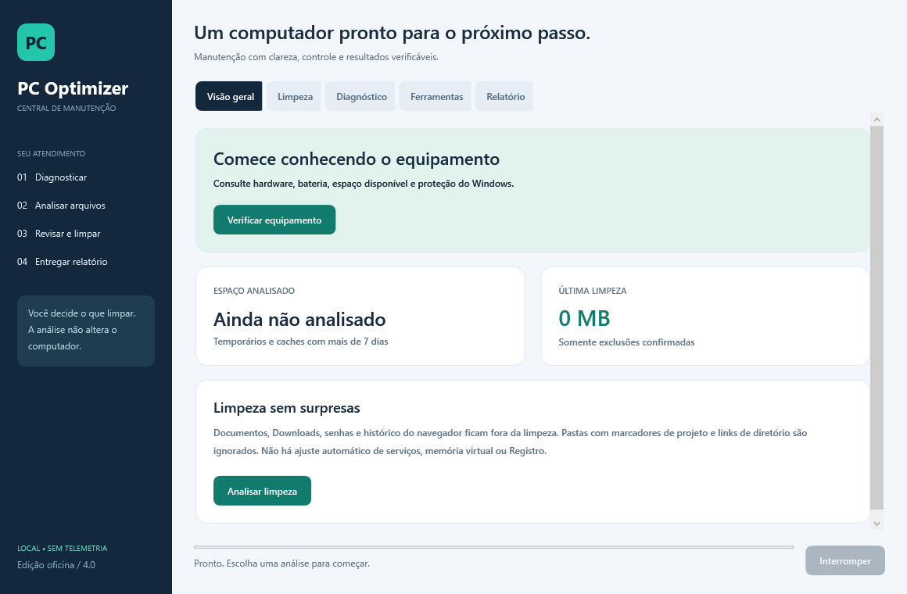

# PC Optimizer — Central de manutenção

Interface desktop em português para o dia a dia de manutenção de computadores e notebooks. PowerShell 5.1 + WPF, sem instalação de dependências, conta, publicidade ou envio de dados.



## Abrir

1. Baixe o [ZIP do projeto](https://github.com/leonccunha21/windows-pc-optimizer/archive/refs/heads/main.zip).
2. **Extraia a pasta inteira**, mantendo `Modules` e `UI` ao lado dos scripts.
3. Abra `Executar-Otimizador.bat`. A interface comum **não exige administrador**.
4. Faça o diagnóstico, analise a limpeza, revise os arquivos e confirme as categorias desejadas.

Use na conta do cliente: elevar com credenciais de outro usuário muda o perfil analisado. Em computadores gerenciados, respeite a política de execução da organização. Não execute o BAT dentro do ZIP. Windows 10/11 com interface desktop; a compatibilidade do aplicativo não altera o ciclo de suporte do Windows.

## O que a edição 4.2 oferece

| Área | Recursos |
|---|---|
| Visão geral | Fluxo de atendimento, espaço analisado e resultado real da última limpeza |
| Limpeza | Prévia por categoria e arquivo, seleção/desmarcação em massa, resultado detalhado e progresso por arquivo; caches Chrome, Edge e Brave; retenção mínima de 7 dias |
| Diagnóstico | Sistema, fabricante/modelo, CPU, RAM, discos, espaço livre, bateria e estado do Defender quando disponível |
| Rede | Diagnóstico local de adaptadores, IPv4, gateway, DNS e perfis; testes DNS/TCP com destino explícito |
| Saúde | Bateria com relatório oficial do Windows (powercfg), capacidade de projeto e ciclos; discos físicos com contadores SMART, temperatura, desgaste e volumes |
| Manutenção | Drivers instalados com status (assinatura/idosidade), atualizações de driver via Windows Update; aplicativos instalados com sugestões de remoção e exclusão confirmada; otimizações seguras (plano de energia, Sensor de Armazenamento, cache de entrega, Lixeira) |
| Atalhos do Windows | Inicialização, aplicativos, armazenamento, segurança, otimização de unidades, restauração, eventos, tarefas, recursos opcionais, dispositivos, energia, Windows Update, informações de sistema |
| Relatório | Cliente/OS, observações, diagnóstico e resultado; HTML imprimível em PDF ou JSON sem caminhos de arquivos excluídos |

Análise e limpeza rodam em um runspace separado. A janela permanece disponível e permite solicitar interrupção entre arquivos. A consulta de hardware termina antes de fechar a janela. Relatórios são salvos apenas por escolha do usuário; não há histórico persistente automático com dados de clientes.

## Saúde e manutenção

A aba **Saúde** consolida as consultas de bateria e de disco. A bateria é medida pelo relatório oficial do Windows (`powercfg /batteryreport`); quando o relatório não existe ou não informa capacidade de projeto, o estado permanece como informação do sistema. O desgaste e temperatura vêm dos contadores SMART do subsistema de armazenamento; contas ausentes são exibidas sem notas de saúde inventadas.

A aba **Manutenção** reúne drivers, aplicativos e ajustes. Tudo é consultado primeiro; nada é instalado, alterado ou removido automaticamente. A remoção de aplicativos é sempre confirmada e remove somente pacotes não marcados como não removíveis para o usuário atual.

As ações de ajuste (plano de energia, Sensor de Armazenamento, cache de Otimização de Entrega, esvaziar Lixeira, desativar inicialização rápida) pedem confirmação explícita. Ações que exigem administrador falham com explicação quando a interface roda sem elevação.


## Janela

A janela WPF define o estilo de borda (`SingleBorderWindow`) com `ResizeMode` ajustável e exibe o botão **Fechar** na barra de título do aplicativo, no cabeçalho da janela. Durante uma operação em andamento, o fechamento é perguntado ao usuário e encerra o runspace em vez de ser ignorado. Atalhos: **F5** analisa, **Esc** solicita interrupção e **Ctrl+E** abre a exportação do relatório.

## Bancada técnica

As consultas da bancada são executadas em segundo plano; informações de inicialização são somente para leitura. Reparos e verificações abrem um novo console Windows, após confirmação e solicitação UAC. O relatório HTML/JSON não inclui caminhos de arquivos removidos; o CSV detalhado **inclui**, sendo exportado apenas após aviso de privacidade.

## Rede e conectividade

A aba **Rede** consolida o diagnóstico local. A consulta usa apenas o ambiente local do Windows (adaptadores, IPv4, gateway, DNS e perfis) e não envia dados. O teste de DNS/TCP só roda com o destino explícito informado pelo usuário; nada é testado sem essa autorização.

## Critérios de limpeza

- Somente raízes permitidas do perfil atual. Não percorre Documents, Downloads ou outras contas.
- Não apaga senhas, cookies ou histórico de navegação.
- Navegadores abertos são ignorados na análise e verificados novamente na exclusão.
- Preserva arquivos recentes, extensões comuns de código/documentos/mídia/arquivos compactados e pastas com marcadores de projeto (`.git`, `package.json`, `pyproject.toml`, `Cargo.toml`, `go.mod`).
- Um arquivo vazio chamado `.optimizer-protect` protege a pasta e seus descendentes.
- Não percorre junctions ou links simbólicos. Antes de excluir, verifica novamente os ancestrais, tamanho e data de modificação.
- Apaga arquivos individuais, nunca diretórios recursivamente. Arquivos em uso ou sem permissão são registrados como ignorados.
- A análise expira em 30 minutos. Após uma limpeza, uma nova análise é obrigatória.
- A exclusão é permanente: revise a prévia. Um ponto de restauração não recupera arquivos pessoais excluídos.

Não há limpeza de Registro, alteração automática de serviços, pagefile, rede ou exclusão de logs na nova interface. Espaço liberado representa os bytes dos arquivos cuja exclusão foi confirmada; não é promessa de ganho de velocidade nem medição de alocação física em discos comprimidos.

## Fluxo de oficina

1. Confirme o backup e registre os sintomas nas observações do atendimento.
2. Consulte o diagnóstico. Status de disco via WMI não substitui SMART completo, e o estado do Defender não certifica ausência de malware.
3. Feche os navegadores, analise e confira os candidatos.
4. Limpe somente as categorias autorizadas e confira removidos/ignorados.
5. Utilize as ferramentas nativas conforme a necessidade e registre o serviço.
6. Salve o relatório. Para PDF, abra o HTML no navegador e escolha **Imprimir → Salvar como PDF**.

## Desenvolvimento e validação

```powershell
./Tests/Validate-Syntax.ps1
./Tests/Optimizer.Tests.ps1
./Tests/Core.Smoke.ps1
./Tests/Technician.Smoke.ps1
./Tests/Network.Smoke.ps1
powershell.exe -NoProfile -STA -File ./Otimizador-GUI.ps1 -ValidateUI
```

Atalhos: **F5** analisa, **Esc** solicita interrupção e **Ctrl+E** abre a exportação do relatório. O progresso da limpeza reflete a contagem de arquivos processados; na análise a barra permanece indeterminada.

Os testes de segurança usam uma pasta temporária própria; nunca executam a limpeza real do computador. CI valida o núcleo no Linux/Windows, Windows PowerShell 5.1 e o fluxo real de análise/limpeza pela interface WPF com arquivos de teste. A validação visual em bancada (DPI, leitores de tela e diferentes versões do Windows) segue o [roteiro de testes](docs/VALIDACAO.md).

## Console legado 3.3

`Otimizar-PC.ps1` permanece para compatibilidade técnica, com 255 definições duplicadas removidas, preservando a última implementação de cada função. O console exige agora **`-Legacy` explícito**. Agendamentos antigos devem ser revisados e desativados: o `-Auto` legado foi bloqueado por segurança. O console legado exige administrador; `-LoadOnly` permite carregar definições sem elevação.

As rotinas legadas não têm as garantias do novo núcleo e **não são chamadas pela interface 4.0**. Incluem mudanças de serviços/pagefile e limpeza de logs; `-Auto`, `-AutoPush`, `-Schedule` e a atualização automática de código estão desativados. Para atualizar, revise o código publicado no GitHub e substitua manualmente após validação. `-LoadOnly` não cria nem sobrescreve logs.

Licença MIT. Projeto independente; não afiliado ao CCleaner. A versão 4.0 melhora a base de uso profissional, sem alegar equivalência de cobertura ou superioridade comprovada a produtos comerciais.
